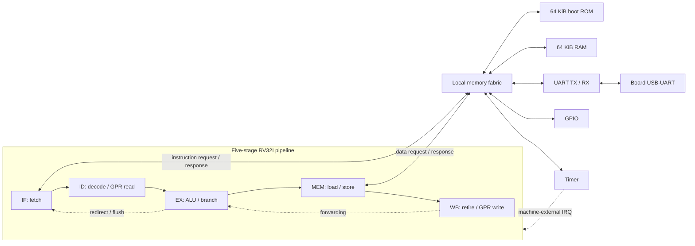

# RV32I Edge SoC

A five-stage, 32-bit RISC-V CPU and bare-metal SoC in SystemVerilog, with an
independent architectural reference model, reproducible verification and a routed
100 MHz implementation on the Digilent Basys 3.

**Status: work in progress.** RTL simulation and FPGA implementation have passed
their recorded gates. The board runs the interrupt firmware, but physical
reset/UART acceptance remains open because a controlled capture contains three
unexpected bytes before `IRQ PASS`. Formal proof was owner-skipped; ASIC work has
not run. [Current engineering status](docs/FPGA_PPA.md)

[Resume / STAR summary](summary.md) · [Verification report](docs/DV_CLOSURE.md) ·
[FPGA results](docs/FPGA_PPA.md) · [Board bring-up](evidence/hardware/README.md) ·
[Open reset proposal](docs/RESET_RELEASE_REVIEW.md)

## Highlights

- **Five-stage pipeline:** IF → ID → EX → MEM → WB, forwarding, load-use stalls,
  age-ordered exceptions, wrong-path flush and ready/valid memory backpressure.
- **Complete project RV32I base scope:** 40 base mnemonics, an explicit execution
  environment, and separately reviewed CSR/trap/MRET/timer-interrupt support.
- **Integrated SoC:** 64 KiB ROM, 64 KiB RAM, UART TX/RX, synchronized GPIO and timer.
- **Independent verification:** retired-state comparison, deterministic seeds,
  whole-memory checks, executable invariants and deliberate faulty RTL/trace tests.
- **Reproducible evidence:** native tool receipts, source/artifact hashes, bounded
  checkpoint builds, retained failures and versioned engineering handoffs.

## Measured results

| Metric | Recorded result | Evidence |
|---|---|---|
| FPGA / clock | Artix-7 `xc7a35tcpg236-1`, 100 MHz / 10 ns | [FPGA report](docs/FPGA_PPA.md) |
| Routed setup closure | WNS **−5.092 → +0.123 ns**, a **5.215 ns** slack improvement | [Repair history](evidence/daily/T043.md) |
| Final hold / DRC | **+0.013 ns** hold slack; **0** DRC violations | [Manifest](evidence/fpga/manifest.json) |
| Resources | **3,291 LUTs** (15.82%), **2,554 FFs** (6.14%), **32/50 BRAM** tiles (64%) | [Manifest](evidence/fpga/manifest.json) |
| Routing | **5,892/5,892** routable nets completed, 0 routing errors | [Manifest](evidence/fpga/manifest.json) |
| Regression inventory | **16 → 28** registered targets: **12 added / 75% growth** | [T019](evidence/daily/T019.md), [T043](evidence/daily/T043.md) |
| Directed ISA matrix | **6,364 retirements / 632 scenario runs**, 40 instruction families and 9 project fault classes | [ISA matrix](docs/ISA_COMPLIANCE_MATRIX.md) |
| Random architectural comparison | **14,458 retirements / 300 scenarios / 6 seeds** | [Random DV](docs/RANDOM_VERIFICATION.md) |

Target-count growth measures regression breadth, not a coverage percentage.
Setup slack improvement is a timing-closure result, not a measured CPU speedup.
Results belong to the source snapshots and scopes named in their reports.

## Architecture



The design uses one clock domain, clock enables for peripheral timing and
separate instruction/data ready-valid interfaces. Each bus permits one accepted
unanswered transaction. Memory and peripheral effects commit at successful
response acceptance; retirement and precise traps are checked separately.

| Region | Address range |
|---|---|
| Boot ROM | `0x00000000–0x0000FFFF` |
| RAM | `0x00010000–0x0001FFFF` |
| UART | `0x10000000–0x1000001F` |
| GPIO | `0x10000020–0x1000003F` |
| Timer | `0x10000100–0x1000010F` |

See the [base architecture](docs/ARCH_SPEC.md),
[interrupt revision](docs/INTERRUPT_SPEC.md),
[pipeline review](docs/PIPELINE_REVIEW.md) and
[integration evidence](docs/INTERRUPT_REPORT.md) for precise contracts and limits.

## Verification and reproduction

The recorded environment is Windows, Python **3.9.13**, Vivado/XSim **2025.2**
(SW build **6299465**) and the pinned local GNU RISC-V toolchain. Full checks
require those installed tools; inspect `.harness/toolchain.json` and the software
toolchain configuration for local paths before reproducing on another machine.
No third-party CPU core is required.

```powershell
python -B scripts/harness.py status
python -B scripts/harness.py validate
python -B scripts/verify.py regress
```

Useful scoped targets include `test-isa-complete`, `test-random`, `test-soc` and
`test-interrupts`. Their exact source snapshots, seeds and native command receipts
are preserved in `evidence/`. The [verification plan](docs/VERIFICATION_PLAN.md)
separates directed/random simulation, assertions, formal, routed implementation,
physical board observations and ASIC evidence.

The GitHub Actions workflow is **manual, self-hosted Windows tooling**. A successful
GitHub-hosted full RTL run is not claimed. Hardware tools never run automatically
on a push. Device operations and new FPGA images require explicit authorization.

## Board result and open work

The approved bitstream was programmed into volatile FPGA SRAM, and physical
UART captures contain `IRQ PASS`. DONE was observed lit. A controlled single
release also produced the prefix `ff 49 f2`, so the strict physical gate remains
**FAIL**; neither partial messages nor filtered suffixes are counted as a pass.

An ideal-release simulation passes; representative reset chatter reproduces a
framing error. The switch waveform is unmeasured, so this is supporting evidence
for a [proposed 20 ms release qualification](docs/RESET_RELEASE_REVIEW.md), not a
conclusive root-cause measurement. That change is **not approved or implemented**.
Any new image needs fresh implementation evidence and separate programming review.

Other limits:

- Finite ISA/reference testing is not external RISC-V certification.
- Formal T023 is explicitly skipped / NOT RUN; ASIC flow is NOT RUN.
- External asynchronous I/O delays are unspecified; no off-chip timing or analog
  metastability proof is claimed.
- The 0.084 W vectorless power estimate has low confidence and is not measured
  board power. No CPI, IPC, workload speedup or measured maximum frequency is claimed.

The backlog has 35 completed mandatory milestones, one owner-skipped milestone,
five unfinished mandatory milestones and four disabled optional tasks.

## Repository map

| Path | Purpose |
|---|---|
| `rtl/` | CPU, memories, bus fabric and peripherals |
| `dv/` | Independent models, scoreboards, generators and self-checking benches |
| `sw/` | Bare-metal startup, linker script and smoke/interrupt firmware |
| `fpga/basys3/` | Top, constraints, memory images and reproducible Tcl |
| `scripts/` | Verification, native process control and engineering harness |
| `docs/` | Specifications, review packages and bilingual handoffs |
| `evidence/` | Receipts, metrics, raw captures and recoverable failure archives |
| `summary.md` | Detailed STAR stories and evidence-backed resume bullets |

Build/cache output is kept in ignored project-local paths. Historical engineering
notes are preserved in [the development history](docs/DEVELOPMENT_HISTORY.md).
The untouched original kit remains in `riscv_edge_soc_codex_kit/`.

Maintainer: [kgr-17](https://github.com/kgr-17). A project license has not yet been
selected; third-party materials retain their existing notices.
